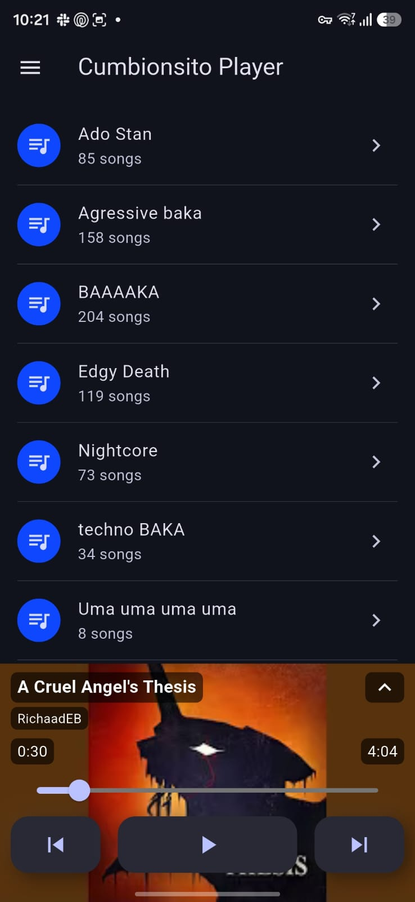
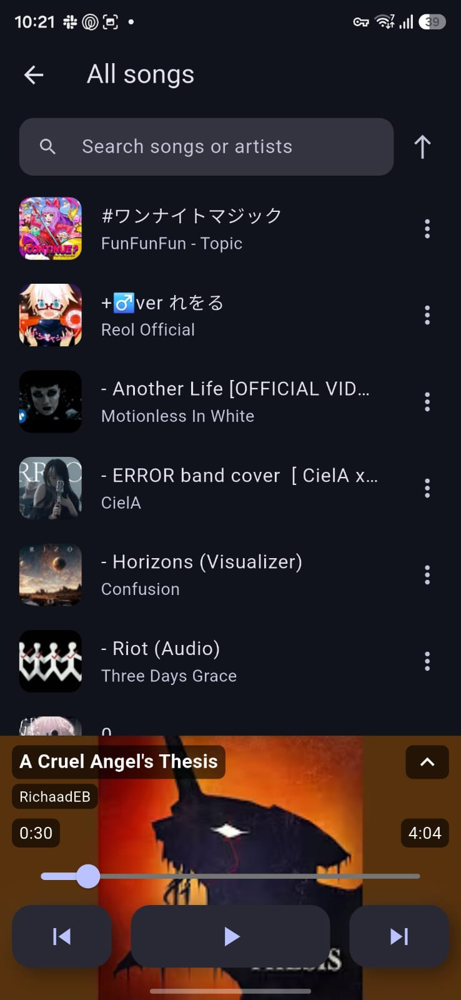
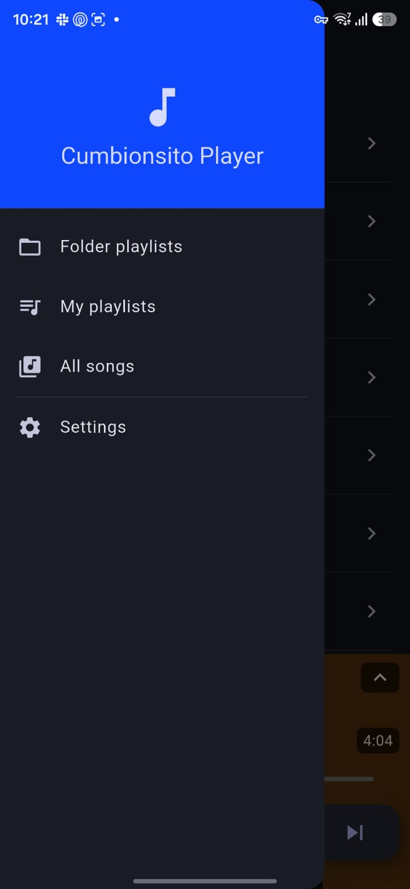
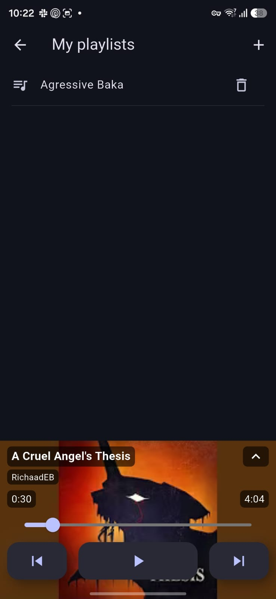
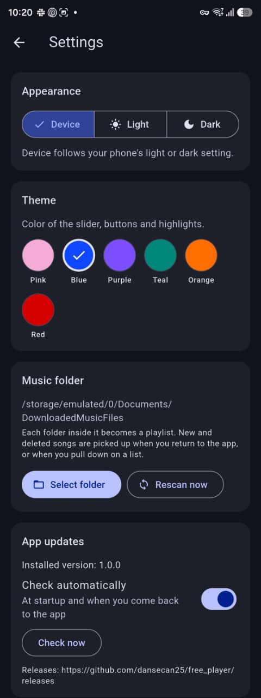

<p align="center">
  
</p>

# Cumbionsito Player

A personal, offline music player for Android, built with Flutter. Point it at the folder where
your music lives, and every folder inside it becomes a playlist. Nothing is uploaded anywhere: the
only network request is the check for new versions on this repository's GitHub Releases.

<p align="center">
  
  
  
</p>

## Features

- **Folder playlists:** each sub-folder of your music folder is a playlist, sorted by name A–Z (or
  Z–A).
- **Your own playlists:** create playlists from any songs in the library.
- **Always in sync:** new and deleted songs are picked up when you return to the app, or when you
  pull down on a list. No restart needed.
- **Playback:** background playback with notification and lock-screen controls, shuffle, repeat
  all, repeat one, and it pauses for calls, alarms and unplugged headphones.
- **Artwork:** small thumbnails in lists for speed, full-size artwork on the song page. Works for
  MP3 and FLAC.
- **Resume:** reopens the last folder playlist and song, paused where you left off.
- **Appearance:** follows your phone's light or dark mode, or set it to always light or dark, and
  pick a theme color (pink, blue, purple, teal, orange or red).
- **Mini player:** the current song's artwork fills the player bar at the bottom.
- **Private by design:** the library database is encrypted with SQLCipher, using a key kept in the
  Android Keystore.
- **Automatic updates:** new versions are downloaded from GitHub Releases, checked, and installed
  after you confirm.

<details>
<summary>More screenshots</summary>

| | | |
|---|---|---|
|  |  |  |

</details>

## Install

Download the latest `cumbionsito-player-<version>.apk` from
[Releases](https://github.com/dansecan25/free_player/releases) and open it on your phone. Android
asks you to allow installs from that app the first time.

On first launch, allow "All files access" so the app can read your music folder, then choose the
folder in **Settings → Music folder**.

> **Coming from "Free Player":** Cumbionsito Player is a new app with its own app ID and signing
> key, so it installs next to the old one. Pick your music folder again, then uninstall Free
> Player. Your music files are not touched.

## In-app updates

- At startup, and when the app comes back to the foreground (at most every 12 hours), it checks the
  latest **published** release. Drafts and pre-releases are ignored.
- When a newer version has an APK, a banner offers to download it. The download is checked against
  the size and SHA-256 digest that GitHub reports, then Android's installer asks for confirmation.
- **Settings → App updates** shows the installed version, can turn automatic checks off, and checks
  right away.
- Only release builds update themselves; debug builds don't.

## Development

The Flutter project is in [`free_music_player/`](free_music_player). You need
[Flutter](https://docs.flutter.dev/get-started/install) 3.47 (stable) and the Android SDK.

```sh
cd free_music_player
flutter pub get
flutter analyze
flutter test
flutter run            # on a connected phone
```

| Folder | Contents |
|---|---|
| `lib/pages/` | Screens |
| `lib/components/` | Shared widgets: player controls, song list pieces, update banner |
| `lib/models/` | Song and playlist models, and the playback/library provider |
| `lib/services/` | Database, folder sync, audio handler, theme and updater |
| `lib/utils/` | Small pure helpers: audio file reading, sorting, versions |
| `lib/constants/` | Fixed values: app name, release URLs, library limits |
| `lib/themes/` | Light and dark themes |
| `android/.../MainActivity.kt` | Updater channel: app version, SHA-256 and the package installer |
| `scripts/` | Development scripts, such as the icon generator |

### App icon

The icons are drawn by
[`free_music_player/scripts/generate_app_icons.py`](free_music_player/scripts/generate_app_icons.py).
It draws the note over a faded crop of
[`free_music_player/scripts/icon-art.jpg`](free_music_player/scripts/icon-art.jpg) (fan art by
tktu383s), and writes the Android adaptive icon (including the themed monochrome layer), the legacy
and round icons, and the iOS, macOS, web and Windows icons. `ART_CROP` and `ART_STRENGTH` in the
script set the framing and how faded the art is. To change the icon, edit the script and run it
again:

```sh
cd free_music_player
python3 scripts/generate_app_icons.py   # needs Pillow: pip install pillow
```

## Releases

Releases are built by [`.github/workflows/release.yml`](.github/workflows/release.yml).

### One-time setup: the signing key

Android only installs an update over an app signed with the same key, so every release must use the
same private keystore. Release builds refuse to fall back to the debug key.

1. Create the keystore once, and keep it and its passwords somewhere safe outside the repository. If
   it is lost, installed copies can't be updated any more.

   ```sh
   keytool -genkeypair -v -keystore <path-to>/cumbionsito-release.jks \
     -alias <key-alias> -keyalg RSA -keysize 4096 -validity 10000
   ```

2. For local release builds, add these to `~/.gradle/gradle.properties` (never to the repository):

   ```properties
   CUMBIONSITO_UPLOAD_STORE_FILE=<path-to>/cumbionsito-release.jks
   CUMBIONSITO_UPLOAD_KEY_ALIAS=<key-alias>
   CUMBIONSITO_UPLOAD_STORE_PASSWORD=<store-password>
   CUMBIONSITO_UPLOAD_KEY_PASSWORD=<key-password>
   ```

3. For CI, add these repository secrets in **Settings → Secrets and variables → Actions**:

   | Secret | Value |
   |---|---|
   | `CUMBIONSITO_KEYSTORE_BASE64` | The keystore file, base64-encoded: `base64 -w0 <path-to>/cumbionsito-release.jks` |
   | `CUMBIONSITO_UPLOAD_KEY_ALIAS` | The key alias |
   | `CUMBIONSITO_UPLOAD_STORE_PASSWORD` | The keystore password |
   | `CUMBIONSITO_UPLOAD_KEY_PASSWORD` | The key password |

### Publishing a version

1. Set `version` in [`free_music_player/pubspec.yaml`](free_music_player/pubspec.yaml), for example
   `1.0.1+5`. The part after `+` is the Android build number and must go up on every release.
2. Commit, then tag that commit with the version before the `+` and push the tag:

   ```sh
   git tag v1.0.1
   git push origin v1.0.1
   ```

3. The workflow checks that the tag matches `pubspec.yaml`, runs the analyzer and tests, builds the
   signed APK, and attaches `cumbionsito-player-<version>.apk` to a **draft** release.
4. Review the draft, write the release notes and publish it. Phones only see the update once it is
   published.

To rebuild an existing tag, open the **Release** workflow on the Actions tab, choose
**Run workflow** and enter the tag.

To build a signed APK locally instead (with the keystore settings from step 2):

```sh
cd free_music_player
flutter build apk --release   # output: build/app/outputs/flutter-apk/app-release.apk
```
